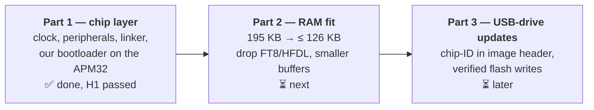
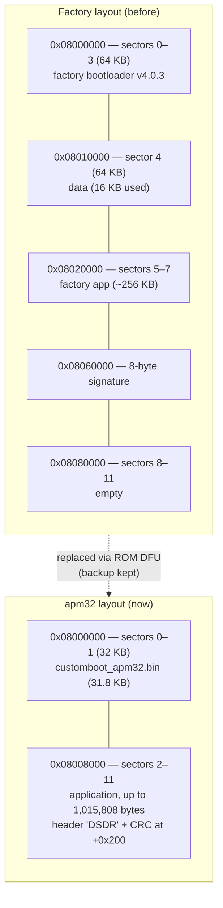
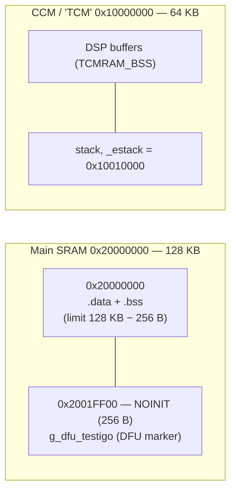
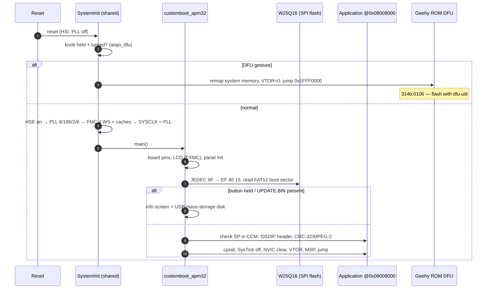
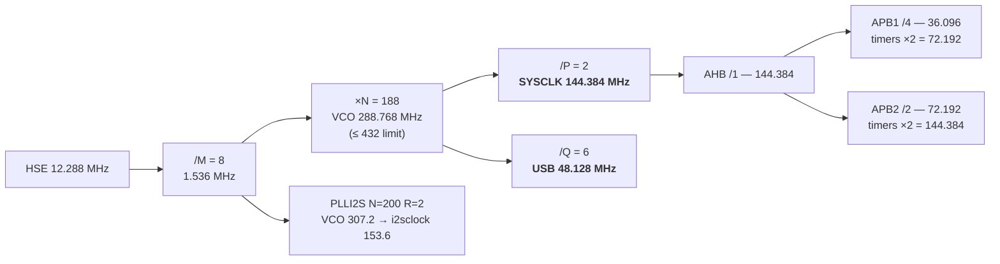
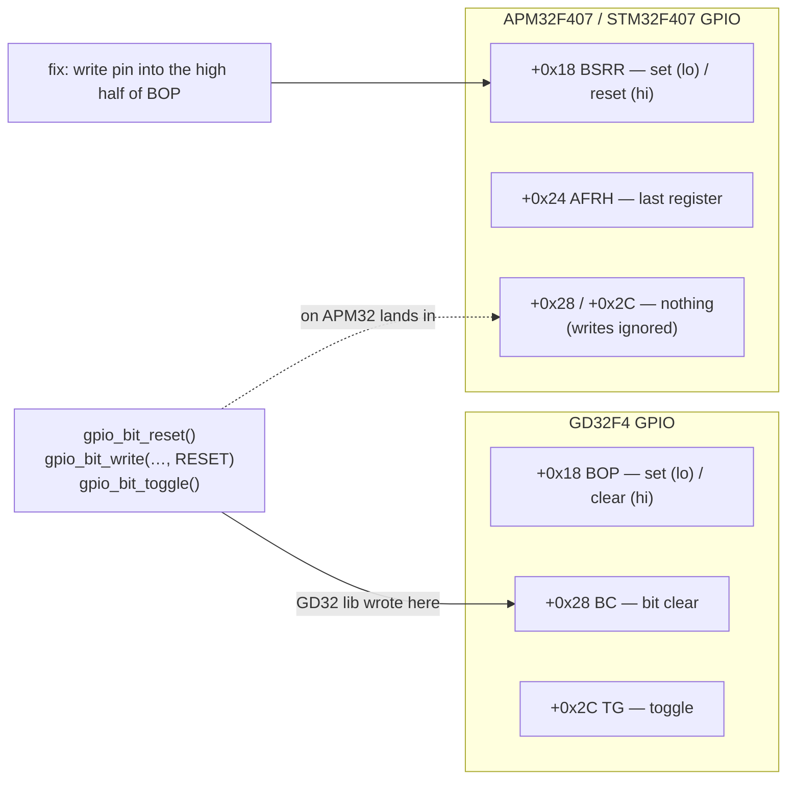
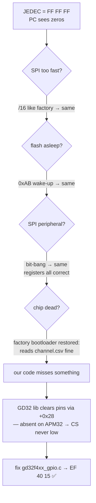
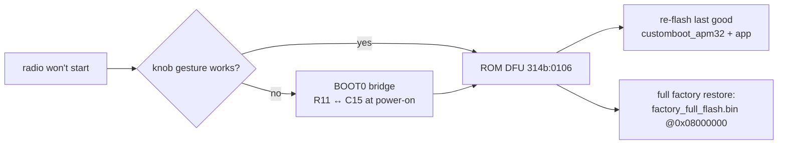

# DeepSDR 101 on the APM32F407 — port notes (Part 1: chip layer)

Some DeepSDR 101 radios ship with a **Geehy APM32F407VGT6** instead of the
GigaDevice GD32F450 this firmware was written for. The APM32 is an
STM32F407-compatible part with **1 MB flash, 128 KB SRAM + 64 KB CCM**, a lower
clock ceiling and none of the GD32-only extras (PLLSAI, IPA, high-drive mode,
GPIO bit-clear/toggle registers).

This document records everything done on branch `apm32` so far: how the board
was analysed, what was changed and why, how it was verified on real hardware,
and what is left. It is written to serve as the PR description.

| | |
|---|---|
| Branch | `apm32` (10 commits on top of `main` @ `eae727a`, V6.58–6.61) |
| Status | **Part 1 done, hardware test H1 passed (2026-11-13)** |
| Design spec | [`docs/superpowers/specs/2026-11-13-apm32-port-design.md`](superpowers/specs/2026-11-13-apm32-port-design.md) |
| Part 1 plan | [`docs/superpowers/plans/2026-11-13-apm32-part1-chip-layer.md`](superpowers/plans/2026-11-13-apm32-part1-chip-layer.md) |
| GD32 builds | **byte-identical** to `main` (verified after every commit) |

---

## 1. Goal and scope

**Goal:** run the open firmware on the APM32 radio as its permanent chip —
everyday listening (AM/FM/SSB, spectrum, waterfall, menus) plus the light
decoders (RDS, CW, APRS, AIS, SSTV…), with firmware updates from the radio's
USB drive.

**Accepted trade-offs:** FT8 and HFDL are dropped (they cannot fit in 128 KB of
RAM next to everything else), the waterfall gets shorter (72 → 40 rows), the UI
is somewhat slower (144 MHz instead of 199.68 MHz).

The work is split into three parts:



**Code organisation:** one build flag, `CHIP_APM32F407`, wired exactly like the
existing `CHIP_F470VG` variant (own build directory, own linker scripts,
`#ifdef` branches in the few files that encode chip specifics). GD32 output is
untouched.

```sh
make apm32              # app  -> build_apm32/, update_apm32.bin   (links once Part 2 is done)
make -C boot apm32      # bootloader -> boot/customboot_apm32.bin
```

---

## 2. Analysing the board

### 2.1 Getting in

| Step | What | Result |
|---|---|---|
| R8 mod | 2.4 kΩ → 22 Ω (as in `INSTALL_HOWTO`, p.6) | PC sees the radio over USB |
| Factory USB drive | button held at power-on | `0483:572a` "STM32 Mass Storage", 1 MiB FAT, only `channel.csv` |
| ROM DFU | BOOT0 bridge R11 ↔ C15 (`INSTALL_HOWTO`, p.7) | **`314b:0106` "Geehy APM32 ISP DFU mode"** — chip confirmed |
| Flash backup | `dfu-util -U` twice, 1 MiB each | identical, sha256 `5d0496fa…499b`; **RDP level 0** (option byte `0xAA`) |

DFU flash layout reported by the Geehy ROM:
`0x08000000: 4×16K + 1×64K + 7×128K` (1 MB, STM32F407 sector map).

### 2.2 What the factory firmware does (ground truth for this chip)

Both factory images (bootloader and app) are built with ST's STM32 HAL — the
vendor runs the APM32 as an STM32F407. Disassembling them gave the settings that
are proven on this exact board:

| Setting | Factory (APM32 radio) | Open firmware on GD32 |
|---|---|---|
| Crystal | 12.288 MHz | 12.288 MHz |
| PLL M/N/P/Q | **8 / 188 / 2 / 6** | 8 / 260 / 2 / 8 (app) |
| SYSCLK | **144.384 MHz** | 199.68 MHz |
| USB clock | 48.128 MHz (+0.27 %) | from PLLSAI, 48.000 MHz |
| AHB / APB1 / APB2 | /1, /4, /2 (boot) · /4 (app) | /1, /4, /2 |
| Flash wait states | **4 + prefetch + I/D cache** | 0 (GD32 zero-wait region) |
| Voltage | VOS scale 1 | high-drive mode |
| SPI flash | SPI1 on PB3/4/5 (AF5), CS = PB6, mode 0, /16 | same pins |

### 2.3 The factory bootloader cannot update this chip

The factory bootloader (`v4.0.3 by BH5HNU`) accepts `update4.bin` from its USB
drive (≤ 320 KB, stack pointer in CCM, 8-byte signature `8f25c865599c5531` at
file offset `0x40000`). A test image stopped forever at **"Erase SECTOR 3…"**:

* its erase helper starts an erase **without waiting for BSY**, and
* its program loop has two silent `b .` traps (on a HAL error, and on a
  read-back mismatch).

A read-back over DFU showed sectors 5–7 erased and **not one word written**. So
on the APM32 the factory update path is broken (the vendor presumably programs
these boards with a debugger), and the factory bootloader was replaced by the
open firmware's own one — see §4.

---

## 3. Flash and RAM layout

### 3.1 Flash



The application map is the same as the GD32F470 (1 MB) variant; only the
erase limit differs from the 512 KB GD32F450.

### 3.2 RAM



* **App:** same CCM stack as on GD32 (the bootloader insists on an initial SP in
  CCM). Main RAM is cut to 128 KB. Today the app needs ~195 KB → the link fails
  with `region 'RAM' overflowed by 63888 bytes`. That is **expected** and is
  Part 2's job.
* **DFU marker pinned:** on GD32 the `.noinit` DFU marker floats behind `.bss`
  (≈ `0x2002F108`), above the bootloader stack (`0x2002F000`). With 128 KB it
  would float *into* the bootloader stack range, so on APM32 it gets its own
  256-byte region at the very top.
* **Bootloader:** stack top `0x2001F000`, `.data + .bss` end at `0x200040EC`.

---

## 4. Boot flow on the APM32



---

## 5. What changed (by area)

### 5.1 Build system and layout — `d7204b1`

| File | Change |
|---|---|
| `APM32F407VG_FLASH.ld` (new) | copy of the F470 script; RAM `128K − 256`; `NOINIT` region at `0x2001FF00` for `.noinit` |
| `boot/APM32F407VG_BOOT.ld` (new) | RAM up to `0x2001F000`, stack top `0x2001F000` |
| `reglas.mk` | `make apm32` (like `update470`), `build_apm32` in `clean` |
| `boot/reglas.mk` | `make -C boot apm32` → `customboot_apm32.bin` |
| `User/cargador.h`, `User/cargador.c`, `boot/boot_main.c` | APM32 treated as a **1 MB** part (same sector table / erase limit as F470); variant label `" APM32"` |
| `User/main.c` | flash-size tag `[APM]` on the info screen |
| `tools/mapa.py`, `tools/tope_check.py` | know the new linker script and the `#if defined(CHIP_F470VG) \|\| defined(CHIP_APM32F407)` guard |

### 5.2 System clock — `038a3fc`

`CMSIS/GD/GD32F4xx/Source/system_gd32f4xx.c`, APM32 branch of the active clock
function (used by **both** app and bootloader):



* Flash: **latency 4 + prefetch + I-cache + D-cache, written and read back
  before** SYSCLK switches to the PLL (on GD32 the code relies on 0 wait states).
* The GD32 **high-drive** block (`PMU_CTL_HDEN/HDS` wait loops) is compiled out —
  it would hang forever on the APM32.
* `_Static_assert`s pin SYSCLK = 144 384 000, VCO ≤ 432 MHz, USB = 48 128 000.

### 5.3 Clock-dependent peripherals — `2af7cac`, `09a5a5e`

| Where | GD32 | APM32 | Why |
|---|---|---|---|
| `User/usb_cdc_hw.c` | PLLSAI → 48.000 MHz | main PLL Q (no PLLSAI on APM32) | PLLSAI does not exist |
| `boot/usb_hw.c` | writes `RCU_ADDCTL` (+0xC0) 48 MHz selector | skipped | register does not exist |
| `User/gd32_i2s.c` PLLI2S | N=400 R=4 (VCO 614 MHz) | **N=200 R=2** | APM32 VCO limit 432 MHz; same 153.6 MHz i2sclock (the old comment's "49.152 MHz" was an arithmetic slip) |
| `User/gd32_i2s.c` codec MCLK (TIMER7) | period 130, pulse 65 | **period 94, pulse 47** | both derived from `MCLK_TIMER_CLK_HZ`; a literal 65 would have given 69 % duty |
| `User/lo_gen_gd32.h` LO timer | 99.84 MHz | 72.192 MHz | APB1 timer clock (LO only used below 300 kHz) |
| `User/lcd_dma.c` | SRAM end `0x20030000` | `0x20020000` | 128 KB |
| `User/ipa_blit.c` | IPA self-test | **never touched**, software drawing | no IPA on APM32 (unmapped → possible BusFault) |
| `boot/boot_main.c` | `pmu_ldo_output_select()` at 144 MHz | skipped | SystemInit set the scale with the PLL off; redoing it at speed briefly selects scale 2 |
| `boot/boot_main.c` info screen | ">512 kB outside zero-wait zone" warning | hidden | the APM32 has no zero-wait zone |

### 5.4 GPIO: the bug only hardware could show — `730a1a3`

The GD32 library drives pins low and toggles them through two registers that
the STM32F407 / APM32F407 **do not have**:



Effect on the APM32: **no pin could ever be driven low** through the library —
including the SPI-flash chip-select PB6. The bootloader read the flash JEDEC ID
as `FF FF FF`, its volume check said *"sector no es de 512"* and the PC saw the
USB disk as all zeros. Fix in `Firmware/Source/gd32f4xx_gpio.c` (four
functions, `#ifdef CHIP_APM32F407`): clear via the high half of BOP/BSRR,
toggle via a read of OCTL + one BOP write.

### 5.5 Tooling fixes — `c9e9c60` and inside the commits above

* `tools/comprueba_update.py`: app region started at the pre-17/10 address
  `0x0800C000`; now `0x08008000` (it falsely rejected a small valid image).
* `tools/copias_bin_check.py`: knows `boot/customboot_apm32.bin`.
* `tools/tope_check.py`, `tools/mapa.py`: see §5.1.

---

## 6. Verification

### 6.1 On the PC (every commit)

| Check | Result |
|---|---|
| GD32 artefacts (`update.bin`, `update_470.bin`, `boot/customboot.bin`, `boot/customboot_470.bin`) rebuilt and compared with `cmp` against a clean local rebuild of `main` | **identical** |
| `comprueba-fw` benches, each run individually and compared with a clean `main` worktree | same 2 pre-existing failures as `main` (`citas_check`, `espectro_coste_check`), nothing new |
| `deepsdr-ui` LO bench (`sim/logen.c`) with GD32 and APM32 timer clocks | 0 failures for both |
| `make apm32` | only error: `RAM overflowed by 63888 bytes` (Part 2) |
| `make -C boot apm32` | links; 31 796 B of 32 768 B |
| Static asserts | SYSCLK, VCO limits, USB clock, PLLI2S, integer MCLK divider, 50 % MCLK duty |
| Binary checks | no high-drive wait loop in APM32 clock code; no IPA access in `ipa_blit_init`; no store to GPIO `+0x28/+0x2C` in APM32 objects; bootloader `.bss` below its stack |
| Whole-branch review (fresh reviewer) | ready for H1; 2 Important findings fixed (MCLK duty, voltage-scale rewrite) |

### 6.2 On the radio — hardware test H1 (2026-11-13)

Installed via ROM DFU: `boot/customboot_apm32.bin` at `0x08000000` and a
660-byte test app (backlight blink, SysTick-timed, header + CRC) at
`0x08008000`.

| H1 step | Expected | Result |
|---|---|---|
| Normal power-on | bootloader validates header/CRC and jumps | ✅ |
| Blink timing | 3 × 0.5 s, 1.5 s pause (proves 144.384 MHz + SysTick) | ✅ |
| Button at power-on | info screen: flash 1024 kB, variant APM32 | ✅ |
| SPI flash | JEDEC `EF 40 15` (W25Q16), FAT12 volume recognised | ✅ after `730a1a3` |
| USB disk | `DEEPSDR Radio Disk` mounts, `channel.csv` byte-identical to backup | ✅ after `730a1a3` |
| Knob gesture | ROM DFU `314b:0106` without opening the case | ✅ |

How the GPIO bug was isolated:



---

## 7. How to build, flash and recover

**Build**

```sh
make -C boot apm32                     # boot/customboot_apm32.bin
make apm32                             # app (after Part 2)
```

**Flash** (radio in ROM DFU — knob gesture: hold the knob pressed, power on,
turn ≥ 2 clicks within ~1 s; or the BOOT0 bridge):

```sh
# always name the device: other DFU-capable USB devices may be attached
dfu-util -d 314b:0106 -a 0 -s 0x08000000 -D boot/customboot_apm32.bin
dfu-util -d 314b:0106 -a 0 -s 0x08008000 -D <app image with header>
# verify: read back the same length with -U and cmp
```

**Recover**



ROM DFU is in silicon and cannot be erased. **Never** use `unprotect`,
`mass-erase`, `:force` or "remove read protection".

---

## 8. Decisions taken during the work

| Decision | Reason | Cost if wrong |
|---|---|---|
| Compare against a **local** clean rebuild of `main`, not the committed `.bin` files | this toolchain produces different bytes than upstream's; rebuilds are deterministic | none |
| DFU marker pinned at `0x2001FF00` | avoid overlap with the bootloader stack under 128 KB | 256 B RAM |
| Keep the bootloader's conservative erase fallback (512 KB) on an unreadable flash-size word | existing deliberate design; current app ≤ 491 KB | app > 491 KB partly erased — impossible today |
| Final branch review **before** flashing H1 | findings are cheapest to fix before touching hardware | none |
| `UPDATE.BIN` on the disk handled as an H1 pre-flight check, not code | chip-ID check in the image header is Part 3 | one BOOT0 recovery |
| Test-image header filled by a small script reusing `cabecera.py`'s CRC instead of running `cabecera.py` | `cabecera.py` appends to the release log `tools/entregas.csv` | none |

## 9. Known gaps and next steps

**Part 2 — RAM fit (next):** 195 KB → ≤ 126 KB: FT8 + HFDL out of the APM32
build, `WATERFALL_ROWS` 72 → 40, `GFX2_BAND_H` 24 → 12, map cache 10 → 4 KB,
then hardware test H2 (full firmware). Also sweep the **app's** GD32 library
calls for further GD32-only registers (the bootloader's are clean).

**Part 3 — USB-drive updates:** chip-ID field in the image header checked
before erasing, per-word read-back, flash cache reset after programming; tests:
wrong-chip file rejected, good file installed, power cut mid-update survived.

**Deferred minors:**
* `tools/comprueba_update.py` still caps the reset vector at 512 KB for 1 MB images.
* USB at 48.128 MHz is +0.27 % (factory-proven; first suspect if a host is picky).
* The app's DFU-menu path enters the ROM with the PLL running (pre-existing; test in H2).
* Sector erase uses the 8-bit program width (slow but valid).
* Info screen "SRAM" value is meaningless on APM32 (reserved half-word).
* The H1 test app lives outside the repo (`../apm32-hello/`); move it under `tools/` if it should be reproducible from the PR.

## 10. Commits

| Commit | Summary |
|---|---|
| `c64e897` | design spec |
| `2be26bb` | spec corrections (PLLI2S, timer clocks, chip-ID note) |
| `5d23649` | Part 1 implementation plan |
| `d7204b1` | build targets and 128K linker scripts |
| `038a3fc` | 144.384 MHz clock, 4 WS + caches, no high-drive |
| `2af7cac` | USB from PLLQ, PLLI2S 200/2, timer clocks, no IPA |
| `320c6e2` | no GD32 zero-wait-zone warning on the bootloader info screen |
| `c9e9c60` | `comprueba_update`: app region starts at `0x08008000` |
| `09a5a5e` | 50 % MCLK duty, no voltage-scale rewrite at 144 MHz |
| `730a1a3` | drive pins low via BOP high half (no `GPIO_BC`/`GPIO_TG`) |
